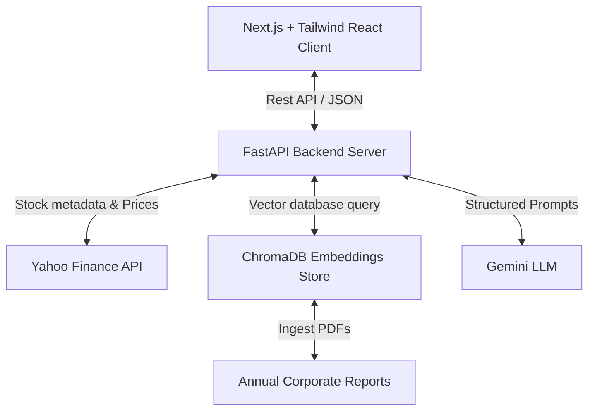

# TradeGPT India 🇮🇳

TradeGPT India is an Agentic RAG-powered Financial Intelligence Copilot designed for Indian retail investors. It brings institutional-grade stock analysis, portfolio diagnostics, SEBI/RBI document RAG search, and quantitative strategy backtesting directly to the retail trader's screen.

---

## 📋 Table of Contents
1. [Project Overview](#-project-overview)
2. [Problem Statement](#-problem-statement)
3. [The Solution](#-the-solution)
4. [Core Features](#-core-features)
5. [Architecture](#-architecture)
6. [Tech Stack](#-tech-stack)
7. [Installation Guide](#-installation-guide)
8. [Running the Backend](#-running-the-backend)
9. [Running the Frontend](#-running-the-frontend)
10. [API Endpoints](#-api-endpoints)
11. [Project Structure](#-project-structure)
12. [Screenshots Inventory](#-screenshots-inventory)
13. [Future Roadmap](#-future-roadmap)

---

## 🔍 Project Overview

TradeGPT India integrates advanced AI orchestration with real-time financial market data to provide clear, verified, and actionable insights. By leveraging Google's Gemini models and structured agent architectures, TradeGPT makes it easy for investors to understand complex market indicators, audit portfolio risks, read corporate reports, and run quantitative strategy simulations.

---

## ⚠️ Problem Statement

Retail investors in the Indian stock market face a dual challenge: **information fragmentation** and **analysis asymmetry**.
* Financial facts are scattered across hundreds of pages of annual reports, earnings calls, financial news channels, and regulatory filings (SEBI, RBI).
* Quantitative testing is historically gated behind costly platforms or requires deep programming knowledge to fetch clean market data, code indicator rules, and run backtests.
* Retail portfolios often suffer from severe concentration risks or sector over-exposure without an easy, automated way to diagnose their health.

---

## ✅ The Solution

TradeGPT India bridges this gap by offering a single integrated dashboard:
1. **Interactive RAG (Retrieval-Augmented Generation)**: Query long PDF corporate reports (like annual reports) with zero-cost embeddings stored locally in ChromaDB, retrieving answers backed by explicit source citations.
2. **AI Portfolio Doctor**: Parses portfolio allocations dynamically, computes real HHI concentration indices, cross-references yfinance data to check actual sector exposures, and runs a comprehensive SWOT evaluation.
3. **Quantitative Strategy Lab**: Lets users backtest technical rules (RSI, MACD, SMA) on NSE stocks, visualizing performance metrics (Sharpe ratio, CAGR, Max Drawdown) alongside interactive equity charts.
4. **Market Intelligence Terminal**: Centralized glassmorphism interface displaying live Indian stock index figures, sector rankings, market breadth indicators, and financial news sentiment.

---

## ✨ Core Features

### 1. Market Intelligence Terminal
* **Real-time Indice Toggling**: Track performance of the NIFTY 50 and SENSEX.
* **Market Breadth Gauges**: Instantly view the Advances/Declines ratio of the market.
* **Sector Performance Heatmap**: Ranks NSE sectors (e.g. Technology, Finance, Energy, Consumer Cyclical) by their real-time performance.
* **Financial News Engine**: Curated, live market news with AI-extracted summaries.

### 2. Portfolio Doctor
* **Dynamic Parsing**: Paste your portfolio holdings (e.g. `TCS 60\nInfosys 40`) directly as text.
* **HHI Concentration Index**: Automatically calculates HHI to measure concentration risk (e.g., HHI > 2500 indicates high concentration).
* **Live Sector Mapping**: Resolves yfinance sector profiles to display true portfolio diversification.
* **AI Analysis Report**: Generates a unified, structured 10-section intelligence audit (Executive Summary, SWOT cards, Allocation breakdown, and Actionable Rebalancing Suggestions).

### 3. Institutional Research
* **Document-grounded RAG**: Upload and search large PDF documents such as annual reports (e.g. HDFC Bank Annual Report 2025-2026).
* **Explicit Citations**: The AI response highlights the exact pages and snippets utilized, preventing hallucinations.
* **AI Summary Panel**: Automatically extracts key financial metrics, growth drivers, and potential headwinds.

### 4. Quantitative Strategy Lab
* **Technical Parameter Configurator**: Setup indicators (e.g. RSI Period: 14, Overbought: 70, Oversold: 30) for backtests.
* **Strategy Metrics Panel**: Returns CAGR, Sharpe Ratio, Win Rate, and Max Drawdown.
* **Visual Equity Curve**: Charts the growth of a hypothetical ₹100,000 investment over the backtest duration.
* **Complete Trade Log**: Shows every buy and sell execution including entry/exit dates and trade returns.

---

## 🛠️ Architecture

TradeGPT uses a decoupled client-server architecture built on Next.js and FastAPI:



---

## 💻 Tech Stack

### Frontend
* **Core**: Next.js 15 (App Router), React 19, TypeScript
* **Styling**: Vanilla CSS, TailwindCSS, ShadCN UI
* **Charts**: Recharts (interactive responsive charts)
* **API Client**: Axios-configured TypeScript service layer

### Backend
* **Core**: FastAPI (Python 3.10+), Uvicorn ASGI server
* **Data Sources**: yfinance (Yahoo Finance integration)
* **AI & RAG**: Google Gemini API (`google-genai` / LangChain), ChromaDB Vector Database, SentenceTransformers embeddings
* **Calculations**: Pandas, NumPy (technical indicator math & backtest logic)

---

## ⚙️ Installation Guide

### Prerequisites
* **Python 3.10+** (Make sure it is added to your environment `PATH`)
* **Node.js 18+** & **npm**
* **Google Gemini API Key**

### 1. Clone & Configure Environment
1. Clone the repository and navigate into the folder:
   ```bash
   git clone https://github.com/your-username/tradeGPT.git
   cd tradeGPT
   ```
2. Create your `.env` file from the example:
   ```bash
   cp .env.example .env
   ```
3. Edit the newly created `.env` file and insert your Gemini API Key:
   ```env
   GEMINI_API_KEY=your_actual_gemini_api_key_here
   ```

---

## 🐍 Running the Backend

1. Navigate to the backend folder:
   ```bash
   cd backend
   ```
2. Create and activate a Python virtual environment:
   ```bash
   python -m venv venv
   source venv/bin/activate  # On Windows: venv\Scripts\activate
   ```
3. Install the required Python packages:
   ```bash
   pip install -r requirements.txt
   ```
4. Perform Document Ingestion (optional, populates local vector db with sample HDFC Bank report):
   ```bash
   python -m backend.rag.ingest
   ```
5. Run the FastAPI application using Uvicorn:
   ```bash
   python -m uvicorn backend.app.main:app --host 127.0.0.1 --port 8000 --reload
   ```
6. The interactive Swagger docs will be available at `http://127.0.0.1:8000/docs`.

---

## ⚡ Running the Frontend

1. Navigate to the frontend folder:
   ```bash
   cd ../frontend
   ```
2. Install npm package dependencies:
   ```bash
   npm install
   ```
3. Start the Next.js development server:
   ```bash
   npm run dev
   ```
4. Open your browser and navigate to `http://localhost:3000`.

---

## 🔌 API Endpoints

### 1. Health Status
* **Endpoint**: `GET /health`
* **Response**: `{"status": "healthy"}`

### 2. Market Intelligence Data
* **Endpoint**: `GET /market-data`
* **Query Parameters**:
  * `index` (string, optional: `NIFTY` or `SENSEX`)
* **Response**: Key statistics, sector rankings, advances/declines count, and news feed.

### 3. Portfolio Analysis
* **Endpoint**: `POST /analyze`
* **Request Body**:
  ```json
  { "portfolio": "TCS 60\nInfosys 40" }
  ```
* **Response**: Calculated HHI, sector weights, holdings analysis, and Gemini SWOT report.

### 4. RAG Institutional Research
* **Endpoint**: `POST /research`
* **Request Body**:
  ```json
  {
    "symbol": "HDFCBANK",
    "query": "What are the major growth drivers mentioned in the annual report?"
  }
  ```
* **Response**: RAG-augmented answers, metrics overview, and document source citations.

### 5. Strategy Backtest
* **Endpoint**: `POST /backtest`
* **Request Body**:
  ```json
  {
    "symbol": "TCS",
    "strategy": "RSI",
    "params": {
      "period": 14,
      "overbought": 70,
      "oversold": 30
    }
  }
  ```
* **Response**: Backtest metrics (CAGR, Sharpe, Max Drawdown), monthly return tables, daily equity arrays, and full execution trade logs.

---

## 📦 Project Structure

```text
tradeGPT/
├── backend/                  # Python FastAPI Backend
│   ├── app/                  # Application core
│   │   ├── routes/           # REST endpoints (analyze, backtest, health, market_data, research)
│   │   ├── schemas/          # Pydantic validation schemas
│   │   └── services/         # Orchestration and API data compilation
│   ├── features/             # Core engines (backtesting, SWOT calculation, stock analyzers)
│   ├── rag/                  # Vector db ingestion and query pipeline
│   ├── requirements.txt      # Backend Python dependencies
│   └── main.py (empty)       # Deprecated (use /backend/app/main.py)
├── frontend/                 # Next.js React Frontend
│   ├── app/                  # Next.js App Router folders and pages
│   │   ├── institutional-research/
│   │   ├── market-intelligence/
│   │   ├── portfolio-intelligence/
│   │   ├── quantitative-strategy/
│   │   └── api.ts            # Frontend API client service layer
│   ├── components/           # Sidebar, Header components
│   └── package.json          # Node dependencies
├── data/
│   └── reports/              # Target corporate annual reports (PDFs)
└── docs/                     # Documentation & specification sheets
    └── screenshots/          # High-quality preview screenshots
```

---

## 🖼️ Screenshots Inventory

The following preview screenshots are placed inside the [`/docs/screenshots/`](file:///c:/projects/tradeGPT/docs/screenshots/) folder:

1. **`01_market_intelligence_terminal.png`**: High-performance dashboard displaying market index switches, sector performances, and AI news feeds.
2. **`02_portfolio_doctor_analysis.png`**: Visualizes computed portfolio health score, holdings breakdown tables, HHI warnings, and AI recommendations.
3. **`03_institutional_research_rag.png`**: RAG query interface showing source citations mapping from HDFC Bank PDF documents.
4. **`04_strategy_lab_backtester.png`**: Demonstrates technical rule configurations and daily equity charts.

---

## 🗺️ Future Roadmap

* **Multiple PDF Support**: Add multi-document uploads in the UI to perform comparative corporate audits.
* **Unified Trading Interface**: Add paper trading simulated accounts to execute strategies generated in the Strategy Lab.
* **Advanced RAG (Agentic RAG)**: Integrate LangGraph routers to dynamically decide when to use vector document lookups versus web searches for market news.
* **Vector Store Hosting**: Migrate from a local SQLite ChromaDB instance to a hosted vector cloud db (Pinecone / Qdrant) for staging deployment.
