# TradeGPT 2.0 — System Architecture & Dependency Map

**Document ID:** `TG-001-ARCH`  
**Date:** November 8, 2026  
**Auditor / Role:** Senior Software Architect & Staff Engineer  
**Baseline Git Commit:** `4b83548` (`HEAD -> master`)  
**Companion Documents:**  
- `docs/TRADEGPT_20_BASELINE.md`
- `docs/TRADEGPT_20_AUDIT_RECONCILIATION.md`
- `docs/TRADEGPT_20_RESTART_PLAN.md`

---

## 1. System Topology Overview

TradeGPT India employs a client-server architecture separating a React 19 / Next.js 16 presentation tier from a Python FastAPI application tier. The system orchestrates external data feeds (Yahoo Finance), local semantic retrieval (ChromaDB), and generative AI synthesis (Google Gemini).

```mermaid
flowchart TD
    subgraph Frontend["Frontend Tier (Next.js 16 + React 19)"]
        UI_Shell["Client Shell (ClientLayout, Header, Sidebar)"]
        Page_Market["Market Intelligence (/market-intelligence)"]
        Page_Portfolio["Portfolio Doctor (/portfolio-intelligence)"]
        Page_Research["Institutional Research (/institutional-research)"]
        Page_Quant["Quant Strategy Lab (/quantitative-strategy)"]
        Page_Settings["Settings Console (/settings)"]
        API_Client["API Client (frontend/app/api.ts)"]
        LocalStore[("Browser localStorage")]

        UI_Shell --> Page_Market
        UI_Shell --> Page_Portfolio
        UI_Shell --> Page_Research
        UI_Shell --> Page_Quant
        UI_Shell --> Page_Settings
        Page_Market --> API_Client
        Page_Portfolio --> API_Client
        Page_Research --> API_Client
        Page_Quant --> API_Client
        UI_Shell <--> LocalStore
    end

    subgraph FastAPI["FastAPI Application Tier (Python 3.10+)"]
        Main["Entrypoint & Lifespan (app/main.py)"]
        MW_CORS["CORSMiddleware (Wildcard + Creds)"]
        MW_ReqId["RequestIdMiddleware"]
        
        Router_Health["GET /health"]
        Router_Market["GET /market-data"]
        Router_Analyze["POST /analyze"]
        Router_Research["POST /research"]
        Router_Backtest["POST /backtest"]

        Main --> MW_CORS --> MW_ReqId
        MW_ReqId --> Router_Health
        MW_ReqId --> Router_Market
        MW_ReqId --> Router_Analyze
        MW_ReqId --> Router_Research
        MW_ReqId --> Router_Backtest
    end

    subgraph Services["Service Abstraction Layer"]
        Svc_Portfolio["PortfolioService"]
        Svc_Research["ResearchService"]
        Svc_Backtest["BacktestService"]

        Router_Analyze --> Svc_Portfolio
        Router_Research --> Svc_Research
        Router_Backtest --> Svc_Backtest
    end

    subgraph Engines["Feature Engines (backend/features/)"]
        Eng_Copilot["Master Copilot (master_copilot.py)"]
        Eng_Doctor["Portfolio Doctor (portfolio_doctor.py)"]
        Eng_Stock["Stock Analyzer (stock_analyzer.py)"]
        Eng_Macro["Macro Dependency Analyzer (macro_dependency_analyzer.py)"]
        Eng_RT["Realtime Intelligence (realtime_intelligence.py)"]
        Eng_BT["Backtesting Engine (backtesting_engine.py)"]
        Dead_Comp["[DEAD CODE] company_comparison.py"]

        Svc_Portfolio --> Eng_Copilot
        Eng_Copilot --> Eng_Doctor
        Eng_Copilot --> Eng_Stock
        Eng_Copilot --> Eng_Macro
        Eng_Copilot --> Eng_RT
        Svc_Research --> Eng_Stock
        Router_Market --> Eng_RT
        Svc_Backtest --> Eng_BT
    end

    subgraph DataStorage["Caches & Persistent Storage"]
        Cache_Market[("In-Memory _market_data_cache")]
        Cache_Research[("In-Memory _research_cache")]
        Cache_RAG[("In-Memory _rag_cache")]
        ChromaStore[("ChromaDB Vector Store (local)")]
        LocalPDF[("data/reports/annual-report-2025-2026.pdf")]

        Eng_RT <--> Cache_Market
        Eng_Stock <--> Cache_Research
        Eng_Stock --> ChromaStore
        Eng_Doctor --> ChromaStore
        Eng_Macro --> ChromaStore
        LocalPDF -->|ingest.py| ChromaStore
    end

    subgraph External["External Providers & APIs"]
        YF["Yahoo Finance API (yfinance)"]
        Gemini["Google Gemini API (google-generativeai)"]
        HF["HuggingFace Hub (sentence-transformers)"]
        CDN_Fonts["Google Fonts & Material Symbols CDN"]

        Eng_RT --> YF
        Eng_Stock --> YF
        Eng_BT --> YF
        Eng_Doctor --> YF
        Eng_Copilot --> Gemini
        Eng_Stock --> Gemini
        Eng_Doctor --> Gemini
        Eng_Macro --> Gemini
        Eng_BT --> Gemini
        ChromaStore --> HF
        Frontend --> CDN_Fonts
    end

    API_Client -->|HTTP / JSON| FastAPI
```



---

## 2. Detailed Component & Subsystem Map

### 2.1 Frontend Presentation Tier (`frontend/`)

- **Root & Shell Layout:**
  - `app/layout.tsx`: Root HTML shell. Enforces font variables (`Hanken_Grotesk`, `Inter`, `JetBrains_Mono`) via `next/font/google` and injects an external CDN stylesheet for `Material Symbols Outlined`.
  - `app/ClientLayout.tsx`: State holder for terminal theme, sidebar collapse state, and bottom status bar (rendering hardcoded health score `84/100`, open positions `3 Active`, region `Mum-1`, and mock latency).
  - `components/Sidebar.tsx`: Fixed 260px navigation rail. Renders persistent watchlist and quick navigation pills.
  - `components/Header.tsx`: Top application header with global search, USD/INR ticker, market open status indicator, and notification action triggers.
  - `components/CommandPalette.tsx`: Global modal triggered via `Cmd/Ctrl+K` for fast routing and theme toggle.
  - `components/ShortcutsModal.tsx`: Keyboard helper modal triggered via `?`.

- **Page Modules:**
  - `app/page.tsx`: Redirect route (`redirect('/market-intelligence')`).
  - `app/market-intelligence/page.tsx`: Terminal workspace featuring an interactive Candlestick chart (`lightweight-charts`), index overview (NIFTY/SENSEX), sector gainers/losers heatmap, and financial news stream. **Defect:** Runs a `Math.random` interval every 3 seconds modifying NIFTY/SENSEX prices.
  - `app/portfolio-intelligence/page.tsx`: Portfolio Doctor workspace. Renders text input for portfolio allocations, invoking `POST /analyze`. Renders HHI concentration gauges, sector breakdown, SWOT cards, and Master Copilot report.
  - `app/institutional-research/page.tsx`: Stock research workspace invoking `POST /research`. Renders technical indicators, AI recommendation badge, growth drivers, and source citations from ChromaDB. **Defect:** Triggers full AI analysis automatically on mount and on symbol URL changes.
  - `app/quantitative-strategy/page.tsx`: Quantitative strategy simulator invoking `POST /backtest`. Renders SVG equity curves and transaction logs. **Defect:** Triggers a backtest on every keystroke in the ticker input without debouncing.
  - `app/settings/page.tsx`: Preferences console for refresh interval, density, sound, currency, and alerts. Values saved to `localStorage` are entirely inert.

- **Frontend API Client (`app/api.ts`):**
  - Configures `API_BASE_URL` from `NEXT_PUBLIC_API_URL` (defaulting to `http://localhost:8000`).
  - Implements `fetchWithRetry`: automatically retries any failed request up to 3 times with exponential backoff (`1000ms * 1.5`).
  - **Defect:** Retries non-idempotent `POST` requests and client-error `4xx` responses, turning single errors into cascading network storms.

---

### 2.2 FastAPI Routing & Endpoint Tier (`backend/app/routes/`)

| Route | Method | Schema In / Out | Service Invoked | Operational Characteristics |
|---|:---:|---|---|---|
| `/health` | `GET` | None / `dict` | Direct return | Returns `{"status": "ok"}`. Shallow: does not check ChromaDB, Gemini, or yfinance. |
| `/market-data` | `GET` | Query params / `dict` | `fetch_market_snapshot` | Returns indices, breadth, sector rankings, and news. When Yahoo is unreachable, returns HTTP 200 with synthetic prices and fake news. |
| `/analyze` | `POST` | `PortfolioRequest` / `PortfolioResponse` | `PortfolioService.generate_report` | Validates API key before input validation. Calls Master Copilot orchestrating ~8 LLM calls synchronously. |
| `/research` | `POST` | `ResearchRequest` / `ResearchResponse` | `ResearchService.generate_research` | Retrieves RAG chunks and yfinance technicals. Instructs Gemini to invent target prices and ownership. |
| `/backtest` | `POST` | `BacktestRequest` / `BacktestResponse` | `BacktestService.run_backtest` | Executes technical rule simulations. Sizing in trade ledger ignores compounded equity. |

---

### 2.3 Service Layer (`backend/app/services/`)

The service layer acts as a thin delegation boundary between HTTP controllers and business engines:
- `portfolio_service.py`: Delegates to `features.master_copilot.generate_master_report_data` and appends formatted source citations.
- `research_service.py`: Delegates to `features.stock_analyzer.generate_structured_research`. In case of unhandled exception, catches the error and returns a fake default dictionary (`HOLD`, `RSI 50`, `Promoter 50%`).
- `backtest_service.py`: Delegates to `features.backtesting_engine.run_backtest_simulation`. In case of unhandled exception, catches the error and returns empty zeroed metrics.

---

### 2.4 Feature Engines & Orchestration (`backend/features/`)

1. **`master_copilot.py` (Master Copilot Orchestrator):**
   - Coordinates multi-agent analysis for portfolios.
   - Extracts top holdings (by allocation percentage).
   - In unstaged changes: dispatches concurrent threads (`ThreadPoolExecutor(max_workers=6)`) across `stock_analyzer`, `macro_dependency_analyzer`, and `realtime_intelligence`.
   - Aggregates sub-module outputs into a master prompt sent to Gemini.
   - Regex-extracts health score: `health_score = 65  # default`.
   - Implements `setup_monkey_patch` wrapping `genai.GenerativeModel.generate_content`.

2. **`portfolio_doctor.py` (Portfolio Doctor Engine):**
   - Parses multi-line portfolio text strings (`TCS 60\nInfosys 40`).
   - Normalizes allocations and calculates the Herfindahl-Hirschman Index (HHI).
   - Resolves holding sectors via `yfinance`.
   - Retrieves semantic chunks from ChromaDB and invokes Gemini using `PORTFOLIO_PROMPT_TEMPLATE` ("You are an expert financial advisor...").

3. **`stock_analyzer.py` (Stock Fundamental & Technical Analyzer):**
   - Resolves stock symbol using `TICKER_MAPPING`.
   - Fetches historical prices, computes RSI(14), SMA(50), SMA(200), and VWAP.
   - Queries ChromaDB for disclosure contexts.
   - Invokes Gemini with `RESEARCH_JSON_PROMPT` instructing the model to provide BUY/HOLD/SELL recommendations, price targets, and shareholding patterns with fallback defaults.
   - Maintains an in-memory dictionary cache `_research_cache`.

4. **`realtime_intelligence.py` (Realtime Market Feed & News Engine):**
   - Fetches live quotes for major indices (`^NSEI`, `^BSESN`, `USDINR=X`), sectoral indices, and top NSE stocks.
   - Fetches RSS news feeds via `yfinance`.
   - Maintains an in-memory dictionary cache `_market_data_cache`.
   - **Critical Defect:** Contains hardcoded synthetic fallback dictionaries returning NIFTY 24000, SENSEX 76800, random candles with `seed(42)`, and 5 fabricated news headlines attributed to real media outlets.

5. **`backtesting_engine.py` (Quantitative Strategy Engine):**
   - Implements backtesting logic for `Buy & Hold`, `RSI` (Mean Reversion), and `SMA Crossover`.
   - Computes CAGR, Sharpe Ratio, Max Drawdown, and Win Rate.
   - Generates Gemini commentary on strategy results.
   - **Critical Defects:**
     - Imports and executes `patch_gemini_retry` on module load.
     - Sizes every trade in `trade_ledger` based on `initial_capital / buy_price` rather than compounded portfolio value.
     - Lacks trade execution delay (fills orders on the signal bar's close price).

6. **`macro_dependency_analyzer.py` (Macroeconomic Factor Analyzer):**
   - Queries ChromaDB for macroeconomic risk disclosures and invokes Gemini.

7. **`company_comparison.py` (Dead Code):**
   - 299 lines of unmaintained CLI comparison code. Not imported or exposed by any service or route.

---

### 2.5 RAG Ingestion & Semantic Retrieval (`backend/rag/`)

- **`ingest.py` (Ingestion Pipeline):**
  - Loads PDF filings from `data/reports/` using `langchain_community.document_loaders.PyPDFLoader`.
  - Splits text via `RecursiveCharacterTextSplitter(chunk_size=1000, chunk_overlap=200)`.
  - Computes dense vector embeddings using `sentence-transformers/all-MiniLM-L6-v2`.
  - Stores vectors in ChromaDB (`backend/chromadb_store/`).
  - Calls `vector_store.persist()` (deprecated/removed in modern Chroma).
  - **Defect:** Ingestion is non-idempotent and lacks company or ticker metadata tagging.
- **`query.py` (Semantic Retrieval):**
  - Initializes ChromaDB connection (`load_vector_store`).
  - `retrieve_relevant_chunks`: Executes `db.similarity_search_with_score(query, k=k)`.
  - **Defects:**
    - Lacks company scoping or metadata filtering. Queries for any company return chunks from whichever report is indexed (currently HDFC Bank only).
    - Contains an unbounded in-memory cache `_rag_cache = {}`.
    - Contains production test hook: `if os.getenv("FORCE_DB_FAILURE") == "true": raise RuntimeError(...)`.

---

## 3. Data Storage, State, and Caching Topology

```text
┌────────────────────────────────────────────────────────────────────────┐
│                        DATA & STORAGE TOPOLOGY                         │
├────────────────────────────────────────────────────────────────────────┤
│                                                                        │
│  [Client Browser LocalStorage]                                         │
│    ├── trade_theme           -> "light" | "dark" (Active)              │
│    ├── trade_watchlist       -> JSON array of tickers (Active)         │
│    ├── trade_portfolio_input -> Raw user portfolio text (Active)       │
│    └── trade_settings_*      -> Refresh, density, sound (INERT)        │
│                                                                        │
│  [In-Memory Backend Dictionaries (Process Lifetime)]                   │
│    ├── _market_data_cache   -> realtime_intelligence.py (TTL: 300s)    │
│    ├── _research_cache      -> stock_analyzer.py (TTL: 300s)           │
│    └── _rag_cache           -> rag/query.py (TTL: 300s)                │
│    * Unbounded growth: No max size, no LRU eviction policy.             │
│                                                                        │
│  [ChromaDB Local Vector Store (Filesystem: backend/chromadb_store/)]   │
│    ├── Embedding Model: sentence-transformers/all-MiniLM-L6-v2         │
│    ├── Collection: "trade_gpt_reports"                                 │
│    └── Index State: Gitignored. Fresh clone results in empty store.    │
│                                                                        │
│  [Committed Raw Assets (Filesystem: data/reports/)]                    │
│    └── annual-report-2025-2026.pdf (30.4 MB binary in git history)     │
│                                                                        │
└────────────────────────────────────────────────────────────────────────┘
```

---

## 4. Architectural Anti-Patterns & Defect Inventory

### 4.1 Compounding Monkey Patches & Quota Exhaustion
`backtesting_engine.py` monkey-patches `genai.GenerativeModel.generate_content` at module import time. `master_copilot.py` defines another identical monkey-patch function (`setup_monkey_patch`), which is invoked in `app/main.py`. This wraps the SDK's method twice:
- 5 retries nested inside 5 retries = **25 physical SDK requests per failure**.
- Exponential backoff reaches **19 minutes** for rate-limit errors (429) and **5 minutes** for non-transient errors (invalid API key).
- Because FastAPI endpoints run synchronously, a single failed call exhausts threadpool workers and hangs the entire application, including `/health`.

### 4.2 Circular Dependency Avoidance via Runtime Imports
In `backend/app/routes/analyze.py` and `backend/app/routes/research.py`, vector store access is implemented as:
```python
from app.main import get_vector_store
db = get_vector_store()
```
This is placed inside the endpoint request functions rather than at module level to evade a circular import loop (`app.main` imports `routes.analyze` -> `routes.analyze` imports `app.main`). This is fragile and indicative of poor state lifecycle management. State should reside in FastAPI `app.state` or a dedicated database container.

### 4.3 7x Repetition of System Boilerplate
Every single engine file in `backend/features/` and `backend/rag/` repeats the same 20 lines of setup code:
```python
SCRIPT_DIR = os.path.dirname(os.path.abspath(__file__))
BACKEND_DIR = os.path.abspath(os.path.join(SCRIPT_DIR, ".."))
if BACKEND_DIR not in sys.path:
    sys.path.insert(0, BACKEND_DIR)
# .env searching across ../.env and ./.env
# Custom setup_logging() writing to local .log file
# CLI main() block with argparse/sys.argv
```
This must be centralized into a unified `backend/core/` package (e.g., `config.py`, `logging.py`).

### 4.4 Unscoped Semantic Retrieval Cross-Contamination
ChromaDB retrieval passes the user's raw query into `similarity_search_with_score` without document or company metadata filters. Because only HDFC Bank's annual report is currently ingested, semantic queries for TCS, Reliance, or Infosys retrieve HDFC Bank disclosure passages and cite them as authoritative evidence for the searched ticker.

### 4.5 Synchronous Handlers on Multi-Second LLM Chains
FastAPI request handlers in `analyze.py`, `research.py`, and `backtest.py` are declared as synchronous `def` rather than `async def`. While FastAPI executes `def` endpoints in Starlette's `anyio` worker threadpool, multi-step LLM operations (taking 15–45 seconds) quickly starve the default worker pool of available threads.

